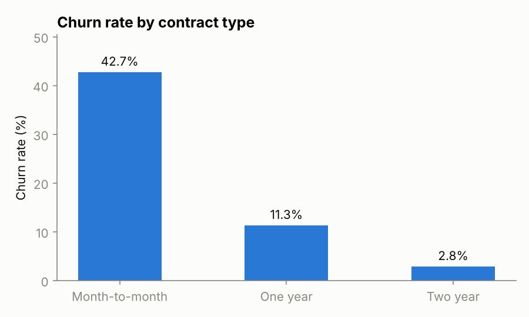
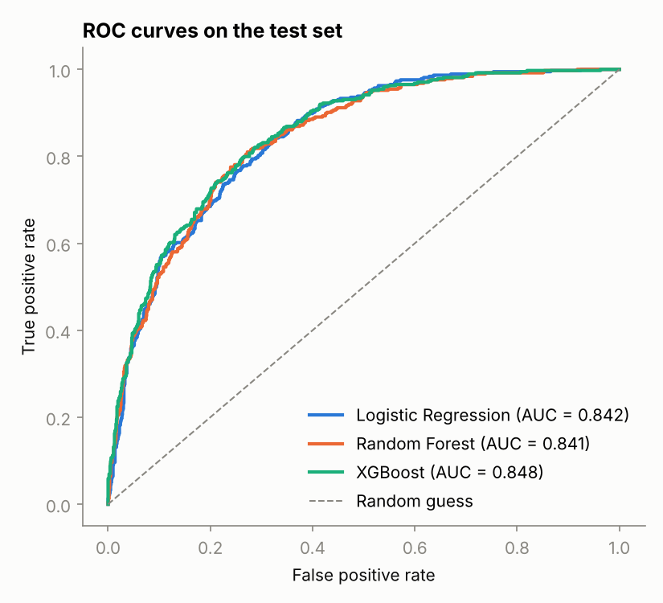
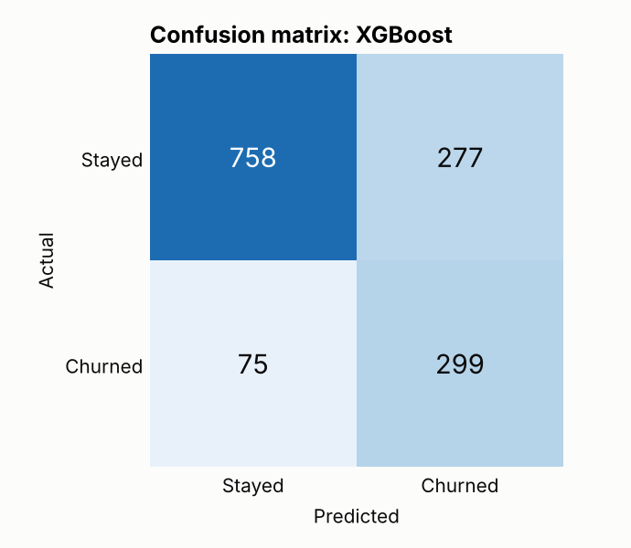
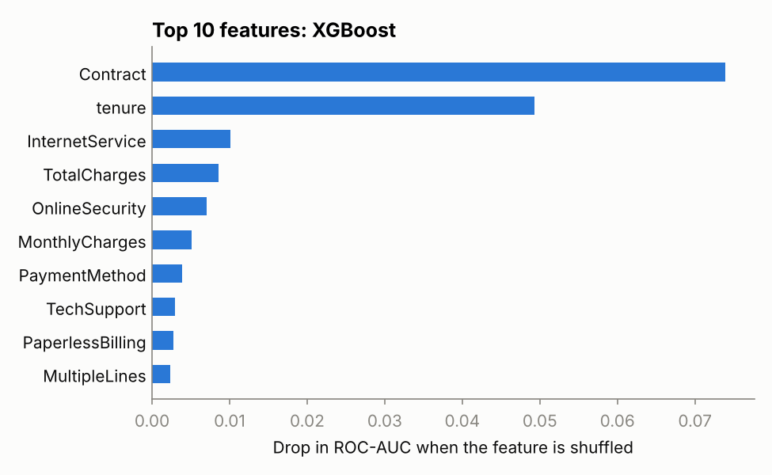

# Customer Churn Prediction

Predicting which telecom customers are likely to cancel their service, using the IBM Telco Customer Churn dataset. The project compares three classifiers, handles the class imbalance, and looks at which customer attributes matter most for the prediction.

## Problem

Keeping an existing customer is cheaper than acquiring a new one. If a company can flag customers who are likely to leave, it can reach out to them with a retention offer before they do. This is a binary classification problem: given a customer's account details, predict whether they churned.

## Dataset

[IBM Telco Customer Churn](https://github.com/IBM/telco-customer-churn-on-icp4d): 7,043 customers and 19 features covering demographics, subscribed services, contract type, billing, and charges.

- **Target:** `Churn` (Yes/No). 26.5% of customers churned, so the classes are imbalanced.
- **Cleaning:** `TotalCharges` is stored as text and is blank for 11 customers with zero tenure. These are new customers who have not been billed yet, so the blanks are set to 0. `customerID` is dropped.

Churn varies a lot by contract type, which already hints at what the models will pick up:



## Approach

1. **Split:** 80/20 stratified train/test split (5,634 / 1,409 customers).
2. **Preprocessing:** numeric features are standardized and categorical features are one-hot encoded, inside a scikit-learn `Pipeline` so the test set never leaks into the fitting step.
3. **Models:** Logistic Regression, Random Forest, and XGBoost.
4. **Class imbalance:** handled with class weights (`class_weight="balanced"` and `scale_pos_weight`) rather than resampling.
5. **Model selection:** 5-fold stratified cross-validation on the training set, scored by ROC-AUC. The test set is only used for the final report.

Accuracy is not reported as the main metric. A model that predicts "no churn" for everyone would score 73.5% accuracy while being useless, so the focus is on ROC-AUC, precision, and recall.

## Results

| Model | CV ROC-AUC | Test ROC-AUC | Precision | Recall | F1 |
|---|---|---|---|---|---|
| Logistic Regression | 0.846 ± 0.012 | 0.842 | 0.504 | 0.783 | 0.614 |
| Random Forest | 0.845 ± 0.010 | 0.841 | 0.539 | 0.775 | 0.636 |
| **XGBoost** | **0.848 ± 0.011** | **0.848** | 0.519 | **0.800** | 0.630 |

Precision, recall, and F1 are for the churn class at a 0.5 threshold.

XGBoost had the highest cross-validated ROC-AUC and was saved as the final model, but the three models are effectively tied: the gaps between them are smaller than the variation across CV folds. In practice, logistic regression would be a reasonable choice here because it is simpler and easier to explain.



On the test set, the final model catches 299 of the 374 customers who churned (80% recall). The cost is 277 false alarms, so about half of the customers it flags would actually have stayed. For a retention campaign that trade-off is usually acceptable, since a missed churner costs more than an unnecessary offer.



## What drives the predictions

Permutation importance measures how much the test ROC-AUC drops when a feature's values are shuffled.



- **Contract type** is by far the most important feature. Month-to-month customers churn at 42.7%, compared with 2.8% on two-year contracts.
- **Tenure** is second. How long someone has been a customer carries much of the remaining signal.
- **Internet service type, charges, and online security** contribute a smaller amount.

These are associations, not causes. The data cannot show that moving a customer to a longer contract would make them stay.

## Project structure

```
├── data/telco_churn.csv      # raw dataset
├── src/
│   ├── data.py               # loading and cleaning
│   ├── train.py              # model comparison, evaluation, figures
│   └── predict.py            # score new customers with the saved model
├── reports/
│   ├── metrics.json          # all metrics from the last run
│   └── figures/              # charts used in this README
└── requirements.txt
```

## How to run

```bash
pip install -r requirements.txt
python src/train.py
```

This retrains all three models, prints the comparison table, regenerates the figures, and saves the best model to `models/best_model.joblib`.

To score customers from a CSV with the same columns as the training data:

```bash
python src/predict.py data/telco_churn.csv
```

## Possible improvements

- Tune the decision threshold against the actual costs of a missed churner and a wasted retention offer.
- Hyperparameter search for the tree models.
- Calibrate the predicted probabilities.
- Wrap the model in a small Streamlit app.
